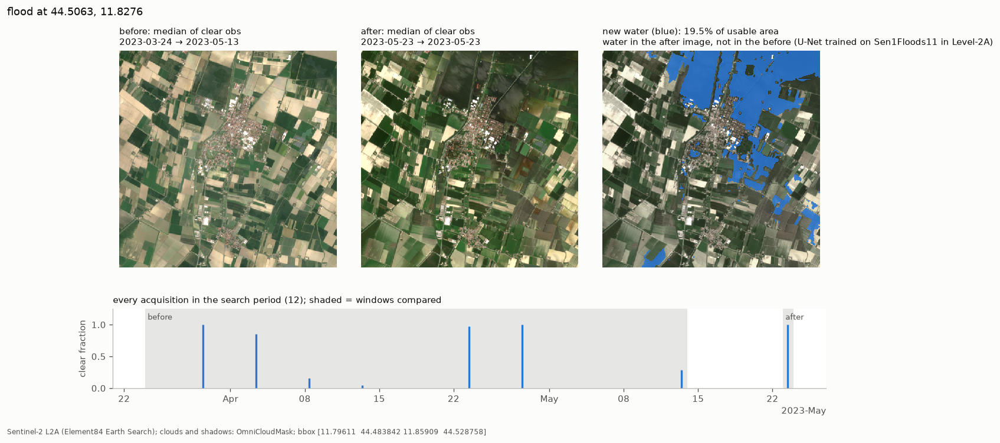
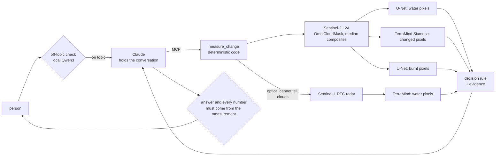

# satellite-change-agent

**Ask a question about any place on Earth in plain language: "Was this town flooded after the storm?",
"Was there new construction here since 2022?" The system finds free satellite images, measures the
change, and answers yes / no / cannot tell, with the numbers and an evidence figure.**

Every learned model in the answer path had to **beat the rule it replaces**, under a protocol fixed
**before any score was computed**, on **flood events or places it had never seen**, with intervals
from a cluster bootstrap over events or places.


| step | rule it replaced | learned model adopted | gain [95 % interval] |
|---|---|---|---|
| which pixels are water, optical (Sentinel-2) | NDWI > 0: 0.690 IoU | **U-Net: 0.833** | +0.143 [+0.083, +0.219] |
| which pixels are water, radar (Sentinel-1, sees through cloud) | VH < t: 0.477 IoU | **TerraMind-1.0, fine-tuned: 0.611** | +0.134 [+0.090, +0.192] |
| flood questions answered correctly (72), end to end | optical images only: 0.722 | **optical U-Net + radar TerraMind when cloudy: 0.889** | +0.167 [+0.031, +0.346] |
| which pixels are cloud or cloud shadow (953 expert-labelled images) | ESA scene classification: 0.644 IoU | **OmniCloudMask, used as published: 0.885** | +0.241 [+0.221, +0.261] |
| which pixels changed through construction (OSCD, 24 cities) | change / noise > 4: 0.188 IoU | **TerraMind-1.0, Siamese, fine-tuned: 0.301** | +0.114 [+0.052, +0.180] |
| which pixels burnt (ImpactMesh-Fire, 42 fires) | change / noise > 4: 0.050 IoU | **U-Net: 0.772** (dNBR fitted: 0.560) | +0.722 [+0.671, +0.773] |

With the new cloud mask, the whole benchmark (150 questions) went from 0.853 to 0.860 (+0.007
[−0.015, +0.029]); with the new change detector it stayed at 0.860; with the new burn detector it rose to
0.887 (+0.027 [+0.006, +0.059]; all 13 wildfire questions right, against 9). Not worse was the condition
for adopting each. The last step, from a map to yes or no, kept its hand-set thresholds: thresholds fitted
on the benchmark (leaving one of its 83 groups out) and a logistic regression did not beat them. Asked "was there new construction?" about 78 flooded areas, the change detector answers
a false "yes" 21 times, against 25 for the rule it replaced; on 570 unburnt patches next to fires, the burn
detector says "yes" 3.9 % of the time, against 5.1 %.

## What it does

```text
You     Was the area at Conselice (44.5063 N, 11.8276 E) flooded around 2023-05-23?

Agent   Yes. Water covered 0.06 % of the 5 km area in the weeks before and 19.6 % just after
        (new water 19.5 %; the threshold is 5 %). Evidence figure attached.

You     Please double check this.

Agent   Measured again with a different before period (31 March to 19 May): yes, new water 20.3 %,
        from 2 clear images before and 1 after.

You     And was there new construction in the same area between summer 2022 and summer 2023?

Agent   No: 1.0 % of the area changed (threshold 3 %).
```

*The conversation is shortened; every number in it is what `measure_change` returns for these inputs.*



## How it works



- **The language model never measures.** Claude only talks and chooses the inputs of one function,
  `measure_change(lat, lon, kind, event_date | periods)`. The function is plain code: same inputs, same
  answer.
- **Two checks in code**, not in the prompt: off-topic questions never reach Claude; the reply's answer
  and every number in it must be found in the function's results, otherwise the reply is rewritten.
- **Clouds are handled physically.** When clouds hide the ground, the system switches to Sentinel-1
  radar, which sees through cloud, instead of guessing.
- **All free.** Open satellite archives (Earth Search, Planetary Computer), open models, and Claude
  through a subscription login (the code refuses to run with a paid API key). Every model fits on one
  24 GB GPU; the deployed networks run on a CPU from ONNX files.

## Research findings

1. **A small U-Net (14M parameters) trained from scratch beats fine-tuned foundation models of 100-300M
   parameters for optical water** (0.833 vs Prithvi-EO-2.0 0.712 and TerraMind 0.698, leaving each flood out). The foundation models are
   within 0.03 on 9 of 10 floods but collapse on one hazy scene whose land is brighter than any training
   flood.
2. **For radar, the foundation model wins** (TerraMind 0.611 vs U-Net 0.558 vs best threshold 0.477),
   with much more stable seeds. Pretraining on radar pays off where the signal is speckled and subtle.
3. **Image processing level is a silent failure mode.** The published Prithvi-EO-2.0 Sen1Floods11 model
   drops from water IoU 0.817 on Level-1C images to 0.634 on the Level-2A images an operational pipeline
   actually reads. We therefore rebuilt Sen1Floods11 in the pipeline's own formats (Level-2A optical,
   RTC radar) on the label grid, and train and test on those.
4. **Muddy flood water has negative NDWI.** Sediment reflects near infrared, so the standard index misses
   it (one tile: 2 % of the water found); short-wave infrared still sees it, and the U-Net learned that.
5. **Radar rescues cloud-covered questions.** 19 of 72 flood questions had no usable optical image;
   radar answered 14 of them, 12 correctly.
6. **Under the published setup, the same training reaches the published state of the art.** On
   Sen1Floods11's official test split: radar TerraMind 0.672 water IoU (published 0.680), optical U-Net
   0.830 (published TerraMind 0.823), radar + optical U-Net mIoU 0.911 (published U-Net 0.914), all
   within the seed-to-seed spread. The lower numbers above come from the harder, operational test.
7. **Sometimes the best model is someone else's.** For clouds, the published OmniCloudMask, used
   unchanged, beat ESA's scene classification by +0.241 IoU and also beat our own fine-tuned TerraMind
   (0.878) and U-Net (0.844). ESA's rule improves a lot with ESA's reprocessing: it scores 0.644 on
   Earth Search's (mostly reprocessed) images but 0.541 on older copies of the same scenes, still far
   below the networks. On bright desert it calls most cloud shadow clear ground.
8. **A rule that sees every change cannot answer a question about one kind of change.** The change rule
   (change of the median image over its date-to-date scatter) called the flooded farmland of Conselice
   "new construction". OSCD's hand-drawn maps contain only urban change, but the common copies have lost
   the images' map position; we put them back on the map from the original files and re-read every city
   as Level-2A median images, the pipeline's own input. A Siamese TerraMind trained on 21 groups of
   cities and tested on the 22nd beat the rule by +0.114 IoU (0.301 vs 0.188); the rule was already at its
   best threshold. FC-Siam-diff from scratch (0.225) became purer than the rule but found no more change:
   with 24 cities, pretraining is what helps. Conselice is now "no".
9. **The question decides the right reference, and a burn index is a strong one.** For "did a wildfire
   burn here?" the generic change rule found 5 % of the burnt land in 42 held-out fires (IoU 0.050): a
   burn changes the bands by about a third, less than the rule's four times the date-to-date scatter of
   summer vegetation. The standard burn index dNBR with a fitted threshold reaches 0.560, so we required
   the network to be judged against that too. A U-Net trained from scratch on ImpactMesh-Fire's burnt-area
   maps, read as the pipeline's own median images, reaches 0.772 (+0.212 [+0.104, +0.300] over dNBR) and
   says "yes" on unburnt land no more often than the change rule (3.9 % against 5.1 %) and far less often
   than dNBR (24.9 %). A Siamese TerraMind reached 0.793, within the U-Net's interval and 7 times
   larger, so the smaller network was taken. The published
   Prithvi-EO-2.0-BurnScars (US scenes, one after image) reaches 0.483: without the before image it
   cannot tell a new burn from an old scar.
10. **For agents, orchestration and arithmetic placement matter as much as the model.** Moving date
    arithmetic from the LLM into code raised a local 8B model from 0.48 to 0.66 on the benchmark.
11. **Every clear date beats two median images, but not yet provably beats the incumbent.** A U-TAE
    (temporal attention over each date and its day, 1.1M parameters, from scratch) reached IoU of burnt
    0.815 on the 42 held-out fires against the median U-Net's 0.772, better on 30 of 42 fires at the same
    false-alarm rate. Against the identical network fed two medians it gains +0.031 [+0.003, +0.049], so the
    time information is worth having. Against the U-Net the interval is +0.043 [−0.011, +0.077]: one large
    fire pulls it below zero, and by the rule written beforehand the U-Net stays.

Full protocols, per-event tables and limits: **[docs/METHODS.md](docs/METHODS.md)**.

## Status and roadmap

| component | status |
|---|---|
| optical water: U-Net replaces NDWI | done |
| radar water for cloudy floods: TerraMind | done |
| comparison with published Sen1Floods11 numbers (official split) | done: on par (within 0.01) |
| cloud mask: OmniCloudMask replaces ESA scene classification | done |
| construction: Siamese TerraMind replaces the change rule (OSCD, located and re-read as Level-2A) | done |
| flood areas still called construction (21 of 78): combine with the water map, or train with flood examples | open |
| burn scars: U-Net replaces the change rule (ImpactMesh-Fire, re-read as Earth Search median images) | done |
| vegetation loss that is not fire (clear-cutting, drought): no training labels yet | open |
| yes/no thresholds: fitted thresholds and a logistic regression against the hand-set ones | done: hand-set kept |
| a model that reads every clear date (U-TAE), tested for burnt land | done: best map (0.815 vs 0.772), not yet significant, U-Net kept |
| every clear date for floods and construction; a second, newer set of fires | open |

## Repository

```text
core/            satellite data access (STAC, COGs), cloud mask, time-series cube, measure_change
core/models/     water detectors (U-Net, TerraMind), cloud detector (OmniCloudMask), change detectors (Siamese
                 TerraMind for construction, U-Net for burnt land), all via ONNX
mcp_server/      MCP servers: measure_change, and the four step functions
agents/          the chat agent (Claude Agent SDK), LangGraph workflow, model back ends
experiments/     b1_* optical water, b2_* radar water, b3_* clouds, b4_* construction, b5_* burnt land,
                 b6_* yes/no thresholds, b7_* every clear date: data copies, training, reports, exports
eval/            the benchmarks (44 and 150 questions), reference pipeline, metrics
examples/        chat.py: a conversation with the agent
tests/           unit and integration tests
docs/            METHODS.md, figures
```

## Run it

```bash
python -m venv .venv && source .venv/bin/activate && pip install -e .     # pipeline (CPU)
python -m venv .venv-ml && .venv-ml/bin/pip install -e ".[ml]"            # training (one GPU)

python -m pytest -q -m "not network"

# the trained networks are not stored in the repository yet (a download will follow); until then,
# train them as below and export them to ONNX:
.venv-ml/bin/python -m experiments.b1_export && .venv-ml/bin/python -m experiments.b2_export
.venv-ml/bin/python -m experiments.b3_export      # OmniCloudMask's published weights -> ONNX
.venv-ml/bin/python -m experiments.b4_export --model terramind   # after training it (below)
.venv-ml/bin/python -m experiments.b5_export --model unet        # after training it (below)

# answer one question with fixed code (no language model)
python -c "from core.measure import measure_change as m; \
  print(m(lat=44.5063, lon=11.8276, kind='flood', event_date='2023-05-23').answer)"

# talk to the agent (needs a Claude Code login and a local Qwen3 server for the off-topic check)
scripts/serve_llm.sh Qwen/Qwen3-8B 0 8101
python examples/chat.py --chat
```

Reproducing the results (water: about 4 hours on four 24 GB GPUs; clouds: about 3 hours more;
construction: about 2.5 hours more; burnt land: about 2.5 hours more; every clear date: about 4 hours more):

```bash
python -m core.data.sen1floods11 && python -m core.data.sen1floods11_l2a && python -m core.data.sen1floods11_s1rtc
python -m experiments.b1_rules && .venv-ml/bin/python -m experiments.b1_train --run-all --gpus 0,1,2,3
python -m experiments.b2_rules && .venv-ml/bin/python -m experiments.b2_train --plan A,B-select --gpus 0,1,2,3
.venv-ml/bin/python -m experiments.b2_report A        # radar table
.venv-ml/bin/python -m experiments.b2_train --plan B-final && .venv-ml/bin/python -m experiments.b2_eval
.venv-ml/bin/python -m experiments.b2_report B-final  # comparison with published numbers
python -m experiments.b1_report                       # optical table
# the networks the agent uses for new places (trained on every flood event), then export to ONNX:
.venv-ml/bin/python -m experiments.b1_train --model unet --event ALL
.venv-ml/bin/python -m experiments.b2_train --plan A-all --gpus 0,1,2
# clouds (CloudSEN12+: download the 9 needed files, 153 GB, into data_cache/cloudsen12/taco/ first)
.venv-ml/bin/python -m core.data.cloudsen12 && python -m core.data.cloudsen12_es
python -m experiments.b3_rules && .venv-ml/bin/python -m experiments.b3_ocm
.venv-ml/bin/python -m experiments.b3_train --all --gpus 0,1,2 && python -m experiments.b3_report A
.venv-ml/bin/python -m experiments.b3_export && .venv-ml/bin/python -m experiments.b3_check
python -m experiments.b3_exam run scl && python -m experiments.b3_exam run ocm && python -m experiments.b3_exam report
# construction (OSCD's original files from the authors' site; Planetary Computer images, about 3 GB)
python -m core.data.oscd_pc download && python -m core.data.oscd_pc check && python -m core.data.oscd_pc
python -m experiments.b4_common && python -m experiments.b4_rules
.venv-ml/bin/python -m experiments.b4_train --all --gpus 0,1,2,3 && python -m experiments.b4_report
.venv-ml/bin/python -m experiments.b4_export --model terramind
for p in B C; do python -m experiments.b4_exam run rule $p && python -m experiments.b4_exam run terramind $p; done
python -m experiments.b4_exam report terramind
# burnt land (ImpactMesh-Fire labels, 50 MB; Earth Search images read on four GPUs, about 1.5 hours)
.venv-ml/bin/python -m core.data.impactmesh_es download && .venv-ml/bin/python -m core.data.impactmesh_es
.venv-ml/bin/python -m core.data.impactmesh_es check     # alignment with the data set's own images
.venv-ml/bin/python -m experiments.b5_common && .venv-ml/bin/python -m experiments.b5_common pack
.venv-ml/bin/python -m experiments.b5_rules && .venv-ml/bin/python -m experiments.b5_train --all --gpus 0,1,2
# Prithvi-EO-2.0-300M-BurnScars: put the model files from Hugging Face in data_cache/models/prithvi_burnscars
.venv-ml/bin/python -m experiments.b5_prithvi partA && .venv-ml/bin/python -m experiments.b5_report
.venv-ml/bin/python -m experiments.b5_export --model unet
python -m experiments.b5_exam run rule && python -m experiments.b5_exam run burn-unet
python -m experiments.b5_exam report burn-unet
# yes/no thresholds (the whole benchmark once with today's path, then the fits)
python -m experiments.b6_exam && python -m experiments.b6_fit
# every clear date (a per-date copy of the burnt-land patches, about 210 GB; then U-TAE and its control)
.venv-ml/bin/python -m core.data.impactmesh_ts
.venv-ml/bin/python -m experiments.b7_train --all --slots 1,2,4,5,5,5 --batch 4 --accum 2
.venv-ml/bin/python -m experiments.b7_report
```

## Data, models and licences

| | source | licence |
|---|---|---|
| Sentinel-2 L2A | Copernicus, via [Element84 Earth Search](https://earth-search.aws.element84.com/v1) | free and open Copernicus data; provider terms apply |
| Sentinel-2 L2A (training images for construction) | Copernicus, via [Microsoft Planetary Computer](https://planetarycomputer.microsoft.com/dataset/sentinel-2-l2a) | free and open Copernicus data; provider terms apply |
| Sentinel-1 RTC | Copernicus, via [Microsoft Planetary Computer](https://planetarycomputer.microsoft.com/dataset/sentinel-1-rtc) | free and open Copernicus data; provider terms apply |
| Sen1Floods11 | Bonafilia et al. 2020, `gs://sen1floods11` | CC BY 4.0 |
| OSCD | Daudt et al. 2018, [the authors' site](https://rcdaudt.github.io/oscd/) | labels CC BY-NC-SA: not redistributed here, nor networks trained on them |
| ImpactMesh-Fire | IBM, DLR, ESA Φ-lab, Hugging Face `ibm-esa-geospatial/ImpactMesh-Fire` (version 1); labels from Copernicus Emergency Management Service maps | CC BY 4.0 |
| CloudSEN12+ | Aybar et al. 2022, 2024, Hugging Face `tacofoundation/cloudsen12` | CC0 |
| OmniCloudMask | Wright et al. 2025, `pip install omnicloudmask` (version 1.8.1, model version 4) | MIT |
| Prithvi-EO-2.0 | NASA / IBM, Hugging Face `ibm-nasa-geospatial` | Apache-2.0 |
| Prithvi-EO-2.0-300M-BurnScars | NASA / IBM, Hugging Face `ibm-nasa-geospatial/Prithvi-EO-2.0-300M-BurnScars` (trained on HLS Burn Scars, CC BY 4.0) | Apache-2.0 |
| TerraMind-1.0 | IBM / ESA, Hugging Face `ibm-esa-geospatial` | Apache-2.0 |
| TerraMind-base-Fire (reference only) | IBM / ESA, Hugging Face `ibm-esa-geospatial/TerraMind-base-Fire`, run with the `impactmesh` package's script | Apache-2.0 |
| Qwen3 | Alibaba, Hugging Face `Qwen` | Apache-2.0 |

Code: Apache-2.0 (see `LICENSE`). Model weights and data are downloaded by scripts, not stored here.

## References

- Bonafilia et al., *Sen1Floods11: a georeferenced dataset to train and test deep learning flood
  algorithms for Sentinel-1*, CVPR Workshops 2020.
- Szwarcman et al., *Prithvi-EO-2.0: a versatile multi-temporal foundation model for Earth observation*, arXiv 2412.02732, 2024.
- Jakubik et al., *TerraMind: large-scale generative multimodality for Earth observation*, arXiv 2504.11171, 2025.
- Daudt, Le Saux, Boulch, Gousseau, *Urban change detection for multispectral earth observation using
  convolutional neural networks*, IGARSS 2018 (OSCD).
- Daudt, Le Saux, Boulch, *Fully convolutional siamese networks for change detection*, ICIP 2018.
- Aybar et al., *CloudSEN12, a global dataset for semantic understanding of cloud and cloud shadow in
  Sentinel-2*, Scientific Data 2022.
- IBM, DLR and ESA Φ-lab, *ImpactMesh-Fire*, Hugging Face `ibm-esa-geospatial/ImpactMesh-Fire`, version 1,
  2025 (developed in ESA Φ-lab's FAST-EO project).
- Key and Benson, *Landscape assessment: ground measure of severity, the Composite Burn Index; and remote
  sensing of severity, the Normalized Burn Ratio*, USDA Forest Service RMRS-GTR-164-CD, 2006 (dNBR).
- Wright et al., *OmniCloudMask*, Remote Sensing of Environment, 2025.
- Garnot and Landrieu, *Panoptic segmentation of satellite image time series with convolutional temporal
  attention networks*, ICCV 2021 (U-TAE).
- Garnot and Landrieu, *Lightweight temporal self-attention for classifying satellite images time series*,
  AALTD workshop, ECML-PKDD 2020 (L-TAE).
- Marsocci et al., *PANGAEA: a global and inclusive benchmark for geospatial foundation models*, arXiv 2412.04204, 2024.
