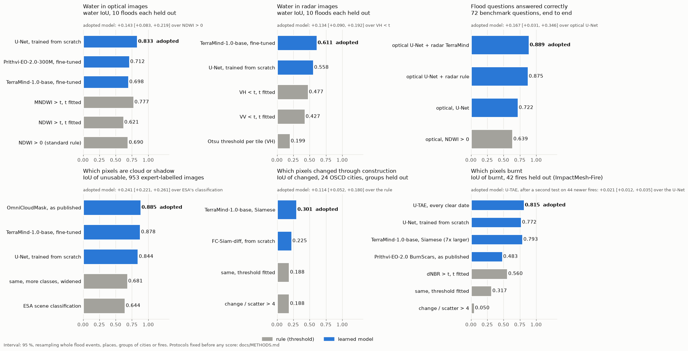
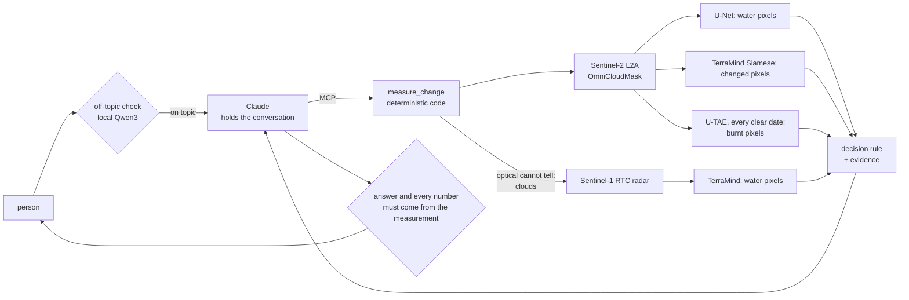

# satellite-change-agent (EO-Agent)

*Called EO-Agent on the website and in my CV; the same project.*

**Ask a question about any place on Earth in plain language: "Was this town flooded after the storm?",
"Did a wildfire burn here in January?", "Was there new construction here since 2022?" The system finds free
satellite images, measures the change, and answers yes / no / cannot tell, with the numbers and an
evidence figure.**

**[Try it live](https://deltasata.github.io/eo/)**: type a question or pick a point on a map. When the
server is off, recorded runs play instead. Or run the measurement yourself on Google's free computers,
with nothing installed on yours:
[](https://colab.research.google.com/github/deltasata/satellite-change-agent/blob/main/examples/try_in_colab.ipynb)

[](https://deltasata.github.io/eo/)

*A wildfire in the Landes forest, south-west France (August 2026), mapped from Sentinel-2 images by the trained network and
checked against the official Copernicus emergency map: yellow = burnt and found, pink = false alarm,
blue = missed. Click for the live page and the moving comparison with the standard burn index.*

## Three results

1. **Floods under cloud are answered with radar, which sees through cloud.** A trained water network on
   the optical images plus a fine-tuned TerraMind network on Sentinel-1 radar raised the share of flood
   questions answered correctly from 0.722 (optical images only) to 0.889. The 95 % interval of the gain
   is +0.031 to +0.346, from resampling whole flood events.
2. **A 1.1-million-parameter network beat the published 168-million-parameter TerraMind-base-Fire** on 44
   wildfires that happened after all of its training data: overlap of the burnt area 0.859 against 0.835
   (difference −0.024 [−0.037, −0.010] for the larger model). *Overlap* (IoU, intersection over union) is
   the area that the predicted and the true maps share, divided by the area that either covers: 1 is
   perfect, 0 is no overlap.
3. **The language model never measures.** It only reads the question and writes the reply. All
   measurement is one fixed function, and code checks that every number in a reply comes from that
   function's output.

**How the models were chosen.** Every learned model had to beat the simple rule it replaces (a
threshold on a band ratio, for example) on flood events or places it had never seen. The test and its
pass mark were written down **before any score was computed**, and the 95 % intervals come from
resampling whole events. Several promising ideas failed this test and were not used. Details:
**[docs/METHODS.md](docs/METHODS.md)**.

## What it does

```text
You     Was the area at Conselice (44.5063 N, 11.8276 E) flooded around 2023-05-23?

Agent   Yes. Water covered 0.06 % of the 5 km area in the weeks before and 19.6 % just after
        (new water 19.5 %; the threshold is 5 %). Evidence figure attached.

You     Please double check this.

Agent   Measured again with a different before period (31 March to 19 May): yes, new water 20.3 %,
        from 2 clear images before and 1 after.

You     And was there new construction in the same area between summer 2022 and summer 2023?

Agent   No: 1.0 % of the area changed (threshold 3 %).
```

*The conversation is shortened; every number in it is what `measure_change` returns for these inputs.*


## Results in detail



| step | rule (or model) it replaced | learned model adopted | gain [95 % interval] |
|---|---|---|---|
| which pixels are water, optical (Sentinel-2) | NDWI > 0: 0.690 IoU | **U-Net: 0.833** | +0.143 [+0.083, +0.219] |
| which pixels are water, radar (Sentinel-1, sees through cloud) | VH < t: 0.477 IoU | **TerraMind-1.0, fine-tuned: 0.611** | +0.134 [+0.090, +0.192] |
| flood questions answered correctly (72), end to end | optical images only: 0.722 | **optical U-Net + radar TerraMind when cloudy: 0.889** | +0.167 [+0.031, +0.346] |
| which pixels are cloud or cloud shadow (953 expert-labelled images) | ESA scene classification: 0.644 IoU | **OmniCloudMask, used as published: 0.885** | +0.241 [+0.221, +0.261] |
| which pixels changed through construction (OSCD, 24 cities) | change / noise > 4: 0.188 IoU | **TerraMind-1.0, Siamese, fine-tuned: 0.301** | +0.114 [+0.052, +0.180] |
| which pixels burnt (ImpactMesh-Fire, 42 fires) | change / noise > 4: 0.050 IoU | **U-Net: 0.772** (dNBR fitted: 0.560) | +0.722 [+0.671, +0.773] |
| which pixels burnt, 44 new fires of 2026 (later than all training) | the U-Net above: 0.838 IoU | **U-TAE on every clear date: 0.859** | +0.021 [+0.012, +0.035] |
| flooded places wrongly called construction (78 benchmark floods) | the construction network above: 21 of 78 | **minus the water network's water: 6 of 78** | 15 fewer (share −0.192 [−0.333, −0.072]) |

With the new cloud mask, the whole benchmark (150 questions) went from 0.853 to 0.860 (+0.007
[−0.015, +0.029]); with the new change detector it stayed at 0.860; with the new burn detector it rose to
0.887 (+0.027 [+0.006, +0.059]; all 13 wildfire questions right, against 9), and stayed there when U-TAE
replaced the U-Net. Removing the water from the construction map cost one answer (0.880): a dam's
reservoir that filled, asked as "did anything change?", now counts as no change, because new water is no
longer counted as construction. The choice of fire images left the benchmark unchanged, because its
questions carry their own periods. For each adoption the condition was that the benchmark did not get
worse. The last step, from a map to yes or no, kept its hand-set thresholds: thresholds fitted
on the benchmark (leaving one of its 83 groups out) and a logistic regression did not beat them. Asked "was there new construction?" about 78 flooded areas, the change detector answers
a false "yes" 21 times, against 25 for the rule it replaced; on 570 unburnt patches next to fires, the burn
detector says "yes" 3.9 % of the time, against 5.1 %.

*Terms in the table:* VV and VH are the two polarisations of the Sentinel-1 radar (VH < t: water where the
VH echo is below a threshold t). NDWI and MNDWI are water indices from two Sentinel-2 bands; dNBR is the
standard burn index. U-TAE is a network that reads every clear image in a period, not two average images.
OSCD is the public data set of urban change in 24 cities. For construction, an overlap of 0.301 sounds
low, but change maps are hard: the same network scores F1 0.46 (F1 is another overlap measure, always
higher than IoU for the same map), and the published results on OSCD's own test cities are F1 0.4-0.6,
in a setup that differs from ours.

## How it works



- **The language model never measures.** Claude only talks and chooses the inputs of one function,
  `measure_change(lat, lon, kind, event_date | periods)`. The function is plain code: same inputs, same
  answer.
- **Two checks in code**, not in the prompt: off-topic questions never reach Claude; the reply's answer
  and every number in it must be found in the function's results, otherwise the reply is rewritten.
- **Clouds are handled physically.** When clouds hide the ground, the system switches to Sentinel-1
  radar, which sees through cloud, instead of guessing.
- **All free.** Open satellite archives (Earth Search, Planetary Computer), open models, and Claude
  through a subscription login (the code refuses to run with a paid API key). Every model fits on one
  24 GB GPU; the deployed networks run on a CPU from ONNX files.

## Research findings

1. **A small U-Net (14M parameters) trained from scratch beats fine-tuned foundation models of 100-300M
   parameters for optical water** (0.833 vs Prithvi-EO-2.0 0.712 and TerraMind 0.698, leaving each flood out). The foundation models are
   within 0.03 on 9 of 10 floods but collapse on one hazy scene whose land is brighter than any training
   flood.
2. **For radar, the foundation model wins** (TerraMind 0.611 vs U-Net 0.558 vs best threshold 0.477),
   with much more stable seeds. Pretraining on radar pays off where the signal is speckled and subtle.
3. **Image processing level is a silent failure mode.** The published Prithvi-EO-2.0 Sen1Floods11 model
   drops from water IoU 0.817 on Level-1C images to 0.634 on the Level-2A images an operational pipeline
   actually reads. We therefore rebuilt Sen1Floods11 in the pipeline's own formats (Level-2A optical,
   RTC radar) on the label grid, and train and test on those.
4. **Muddy flood water has negative NDWI.** Sediment reflects near infrared, so the standard index misses
   it (one tile: 2 % of the water found); short-wave infrared still sees it, and the U-Net learned that.
5. **Radar rescues cloud-covered questions.** 19 of 72 flood questions had no usable optical image;
   radar answered 14 of them, 12 correctly.
6. **Under the published setup, the same training reaches the published state of the art.** On
   Sen1Floods11's official test split: radar TerraMind 0.672 water IoU (published 0.680), optical U-Net
   0.830 (published TerraMind 0.823), radar + optical U-Net mIoU 0.911 (published U-Net 0.914), all
   within the seed-to-seed spread. The lower numbers above come from the harder, operational test.
7. **Sometimes the best model is someone else's.** For clouds, the published OmniCloudMask, used
   unchanged, beat ESA's scene classification by +0.241 IoU and also beat our own fine-tuned TerraMind
   (0.878) and U-Net (0.844). ESA's rule improves a lot with ESA's reprocessing: it scores 0.644 on
   Earth Search's (mostly reprocessed) images but 0.541 on older copies of the same scenes, still far
   below the networks. On bright desert it calls most cloud shadow clear ground.
8. **A rule that sees every change cannot answer a question about one kind of change.** The change rule
   (change of the median image over its date-to-date scatter) called the flooded farmland of Conselice
   "new construction". OSCD's hand-drawn maps contain only urban change, but the common copies have lost
   the images' map position; we put them back on the map from the original files and re-read every city
   as Level-2A median images, the pipeline's own input. A Siamese TerraMind trained on 21 groups of
   cities and tested on the 22nd beat the rule by +0.114 IoU (0.301 vs 0.188); the rule was already at its
   best threshold. FC-Siam-diff from scratch (0.225) became purer than the rule but found no more change:
   with 24 cities, pretraining is what helps. Conselice is now "no".
9. **The question decides the right reference, and a burn index is a strong one.** For "did a wildfire
   burn here?" the generic change rule found 5 % of the burnt land in 42 held-out fires (IoU 0.050): a
   burn changes the bands by about a third, less than the rule's four times the date-to-date scatter of
   summer vegetation. The standard burn index dNBR with a fitted threshold reaches 0.560, so we required
   the network to be judged against that too. A U-Net trained from scratch on ImpactMesh-Fire's burnt-area
   maps, read as the pipeline's own median images, reaches 0.772 (+0.212 [+0.104, +0.300] over dNBR) and
   says "yes" on unburnt land no more often than the change rule (3.9 % against 5.1 %) and far less often
   than dNBR (24.9 %). A Siamese TerraMind reached 0.793, within the U-Net's interval and 7 times
   larger, so the smaller network was taken. The published
   Prithvi-EO-2.0-BurnScars (US scenes, one after image) reaches 0.483: without the before image it
   cannot tell a new burn from an old scar.
10. **For agents, orchestration and arithmetic placement matter as much as the model.** Moving date
    arithmetic from the LLM into code raised a local 8B model from 0.48 to 0.66 on the benchmark.
11. **Every clear date beats two median images, proven on a second test set.** A U-TAE (temporal
    attention over each date and its day, 1.1M parameters, from scratch) reached IoU of burnt 0.815 on the
    42 held-out fires against the median U-Net's 0.772; against the identical network fed two medians it
    gains +0.031 [+0.003, +0.049], so the time information is worth having. But against the U-Net the
    interval was +0.043 [−0.011, +0.077], so the U-Net stayed. On 44 new fires of 2026, later than every
    training fire and labelled with ImpactMesh's own rule (reproduced exactly), U-TAE won with the whole
    interval above zero (0.859 vs 0.838, +0.021 [+0.012, +0.035], better on 37 of 44 fires) and now draws
    the burn map.
12. **More sensors did not help, and an independent test changed the ranking.** The same U-TAE given
    Sentinel-1 radar and elevation as well tied on the new fires (0.859) and was worse on the old ones
    (0.722 against 0.815; the radar dates make it miss burnt land on four fires, for reasons not
    understood), so it was dropped. The published TerraMind-base-Fire (168M parameters, four dates of optical, radar and
    elevation) leads on the data set's own held-out fires (0.864) but scores 0.835 on the new fires, below
    our 1.1M-parameter U-TAE (−0.024 [−0.037, −0.010]). A score on a data set's own test split is not the
    same as a score on new events.
13. **More data helped only when it meant the same thing as the test labels.** An independent review of
    the whole project proposed three improvements, each tested under a protocol written in advance:
    - **Adopted:** removing the water network's water from the construction map cut false "yes" on flooded
      land from 21 to 6 of 78, with urban change unchanged (0.304 vs 0.301).
    - **SpaceNet 7** (new buildings in 60 places) lowered urban change to 0.222.
    - **MMFlood** (92 more flood events, emergency outlines) lowered radar water to 0.568 from 0.611.
    - In both failures the added labels were narrower than the test's, and the network became more
      cautious: more precise, but missing more.

14. **Which images a question uses matters as much as the network.** Wildfire questions had borrowed the
    flood periods, whose after period begins three days *before* the event. The burn network was trained
    on images from a week to three months after a fire. Taking, on each side, the 8 images nearest the
    fire that are at least 10 % cloud-free, within the training limits, raised the right answers on 228
    fire questions from 0.855 to 0.996 (+0.140 [+0.076, +0.221]), with no "cannot tell" left. The month
    questions went from 8 of 13 to 13 of 13. (The 2026 fires had already served one earlier test, of
    the burn network; see the Limits in METHODS.)

Full protocols, per-event tables and limits: **[docs/METHODS.md](docs/METHODS.md)**.

## Status and roadmap

| component | status |
|---|---|
| optical water: U-Net replaces NDWI | done |
| radar water for cloudy floods: TerraMind | done |
| comparison with published Sen1Floods11 numbers (official split) | done: on par (within 0.01) |
| cloud mask: OmniCloudMask replaces ESA scene classification | done |
| construction: Siamese TerraMind replaces the change rule (OSCD, located and re-read as Level-2A) | done |
| flood areas still called construction (21 of 78): combine with the water map, or train with flood examples | done: water removed, 21 → 6 |
| more training labels: SpaceNet 7 (urban change), MMFlood (radar water) | done: both made the networks more cautious; not adopted |
| burn scars: U-Net replaces the change rule (ImpactMesh-Fire, re-read as Earth Search median images) | done |
| vegetation loss that is not fire (clear-cutting, drought): no training labels yet | open |
| yes/no thresholds: fitted thresholds and a logistic regression against the hand-set ones | done: hand-set kept |
| a model that reads every clear date (U-TAE), tested for burnt land | done: best map (0.815 vs 0.772), not yet significant, U-Net kept |
| a second, newer set of fires (CEMS 2026); radar and elevation for burnt land; TerraMind-base-Fire | done: U-TAE replaces the U-Net; radar not used |
| why radar hurts on some fires; radar for fires under cloud | dropped: no gain on the new fires |
| every clear date for floods and construction | open |
| which images a fire question uses (8 nearest each side, within the training limits) | done: right answers 0.855 → 0.996 |
| the LangGraph workflow measures with the adopted detectors (one `measure_change` call) | done |

## Repository

```text
core/            satellite data access (STAC, COGs), cloud mask, time-series cube, measure_change
core/models/     water detectors (U-Net, TerraMind), cloud detector (OmniCloudMask), change detectors (Siamese
                 TerraMind for construction, U-TAE on every clear date for burnt land), all via ONNX
mcp_server/      MCP servers: measure_change, and the four step functions
agents/          the chat agent (Claude Agent SDK), LangGraph workflow, model back ends
experiments/     b1_* optical water, b2_* radar water, b3_* clouds, b4_* construction, b5_* burnt land,
                 b6_* yes/no thresholds, b7_* every clear date, b8_* fires of 2026 and radar,
                 b9_* flooded land, SpaceNet 7, MMFlood: data copies, training, reports, exports
eval/            the benchmarks (44 and 150 questions), reference pipeline, metrics
examples/        chat.py: a conversation with the agent
tests/           unit and integration tests
docs/            METHODS.md, figures
```

## Run it

**Without installing anything:** the [live page](https://deltasata.github.io/eo/) (chat with the agent), or the
notebook [](https://colab.research.google.com/github/deltasata/satellite-change-agent/blob/main/examples/try_in_colab.ipynb),
which runs the measurement on Google's computers. Choose a place, the kind of event and a date, and get the
answer with its figure in a few minutes.

**On your own computer** (Python 3.12, CPU only):

```bash
git clone https://github.com/deltasata/satellite-change-agent && cd satellite-change-agent
python -m venv .venv && source .venv/bin/activate && pip install -e . "omnicloudmask==1.8.1" onnx
python scripts/get_models.py          # trained networks (1.2 GB) + the cloud mask from its authors
python -c "from core.measure import measure_change as m; \
  r = m(lat=44.5063, lon=11.8276, kind='flood', event_date='2023-05-23'); print(r.answer, r.rule, r.figure)"
```

The construction network is not published (its training labels are CC BY-NC-SA). Without it, construction
questions use the change rule, and the answer says so.

To talk to the agent you need a Claude Code login and a local Qwen3 server for the off-topic check
(`scripts/serve_llm.sh Qwen/Qwen3-8B 0 8101`, then `python examples/chat.py --chat`). Tests:
`python -m pytest -q -m "not network"`. To retrain every network and recompute every table:
**[docs/REPRODUCE.md](docs/REPRODUCE.md)**.

## Data, models and licences

| | source | licence |
|---|---|---|
| Sentinel-2 L2A | Copernicus, via [Element84 Earth Search](https://earth-search.aws.element84.com/v1) | free and open Copernicus data; provider terms apply |
| Sentinel-2 L2A (training images for construction) | Copernicus, via [Microsoft Planetary Computer](https://planetarycomputer.microsoft.com/dataset/sentinel-2-l2a) | free and open Copernicus data; provider terms apply |
| Sentinel-1 RTC | Copernicus, via [Microsoft Planetary Computer](https://planetarycomputer.microsoft.com/dataset/sentinel-1-rtc) | free and open Copernicus data; provider terms apply |
| Sen1Floods11 | Bonafilia et al. 2020, `gs://sen1floods11` | CC BY 4.0 |
| OSCD | Daudt et al. 2018, [the authors' site](https://rcdaudt.github.io/oscd/) | labels CC BY-NC-SA: not redistributed here, nor networks trained on them |
| ImpactMesh-Fire | IBM, DLR, ESA Φ-lab, Hugging Face `ibm-esa-geospatial/ImpactMesh-Fire` (version 1); labels from Copernicus Emergency Management Service maps | CC BY 4.0 |
| Copernicus EMS rapid mapping (burnt-area maps of 2026, the new test set) | © European Union, Copernicus Emergency Management Service, [rapidmapping.emergency.copernicus.eu](https://rapidmapping.emergency.copernicus.eu); downloaded by `core/data/cems.py` | free use with this attribution; maps not redistributed here |
| Copernicus DEM GLO-30 | © DLR e.V. 2010-2014 and © Airbus Defence and Space GmbH 2014-2018, provided under COPERNICUS by the European Union and ESA; via [Microsoft Planetary Computer](https://planetarycomputer.microsoft.com/dataset/cop-dem-glo-30) | free use with this attribution |
| SpaceNet 7 (Van Etten et al. 2021) | building outlines, 60 areas; [AWS open data](https://registry.opendata.aws/spacenet/) | CC BY-SA 4.0 (not redistributed) |
| MMFlood (Montello et al. 2022) | flood masks of 95 events; [Zenodo 6534637](https://zenodo.org/records/6534637) | CC BY 4.0 (not redistributed) |
| JRC Global Surface Water (Pekel et al. 2016) | permanent water for MMFlood's labels; via [Microsoft Planetary Computer](https://planetarycomputer.microsoft.com/dataset/jrc-gsw) | free use with attribution |
| CloudSEN12+ | Aybar et al. 2022, 2024, Hugging Face `tacofoundation/cloudsen12` | CC0 |
| OmniCloudMask | Wright et al. 2025, `pip install omnicloudmask` (version 1.8.1, model version 4) | MIT |
| Prithvi-EO-2.0 | NASA / IBM, Hugging Face `ibm-nasa-geospatial` | Apache-2.0 |
| Prithvi-EO-2.0-300M-BurnScars | NASA / IBM, Hugging Face `ibm-nasa-geospatial/Prithvi-EO-2.0-300M-BurnScars` (trained on HLS Burn Scars, CC BY 4.0) | Apache-2.0 |
| TerraMind-1.0 | IBM / ESA, Hugging Face `ibm-esa-geospatial` | Apache-2.0 |
| TerraMind-base-Fire (reference only) | IBM / ESA, Hugging Face `ibm-esa-geospatial/TerraMind-base-Fire`, run with the `impactmesh` package's script | Apache-2.0 |
| Qwen3 | Alibaba, Hugging Face `Qwen` | Apache-2.0 |
| **This project's trained networks** (water, radar water, burnt land) | [GitHub Release models-v1](https://github.com/deltasata/satellite-change-agent/releases/tag/models-v1), `scripts/get_models.py` | CC BY 4.0 (credit this repository and the data sets they were trained on) |

Code: Apache-2.0 (see `LICENSE`). Model weights and data are downloaded by scripts, not stored here.

## References

- Bonafilia et al., *Sen1Floods11: a georeferenced dataset to train and test deep learning flood
  algorithms for Sentinel-1*, CVPR Workshops 2020.
- Szwarcman et al., *Prithvi-EO-2.0: a versatile multi-temporal foundation model for Earth observation*, arXiv 2412.02732, 2024.
- Jakubik et al., *TerraMind: large-scale generative multimodality for Earth observation*, arXiv 2504.11171, 2025.
- Daudt, Le Saux, Boulch, Gousseau, *Urban change detection for multispectral earth observation using
  convolutional neural networks*, IGARSS 2018 (OSCD).
- Daudt, Le Saux, Boulch, *Fully convolutional siamese networks for change detection*, ICIP 2018.
- Aybar et al., *CloudSEN12, a global dataset for semantic understanding of cloud and cloud shadow in
  Sentinel-2*, Scientific Data 2022.
- IBM, DLR and ESA Φ-lab, *ImpactMesh-Fire*, Hugging Face `ibm-esa-geospatial/ImpactMesh-Fire`, version 1,
  2025 (developed in ESA Φ-lab's FAST-EO project).
- Key and Benson, *Landscape assessment: ground measure of severity, the Composite Burn Index; and remote
  sensing of severity, the Normalized Burn Ratio*, USDA Forest Service RMRS-GTR-164-CD, 2006 (dNBR).
- Wright et al., *OmniCloudMask*, Remote Sensing of Environment, 2025.
- Garnot and Landrieu, *Panoptic segmentation of satellite image time series with convolutional temporal
  attention networks*, ICCV 2021 (U-TAE).
- Garnot and Landrieu, *Lightweight temporal self-attention for classifying satellite images time series*,
  AALTD workshop, ECML-PKDD 2020 (L-TAE).
- Marsocci et al., *PANGAEA: a global and inclusive benchmark for geospatial foundation models*, arXiv 2412.04204, 2024.
