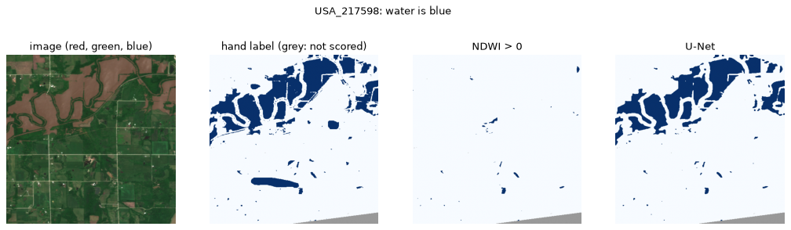
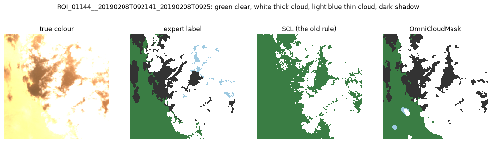
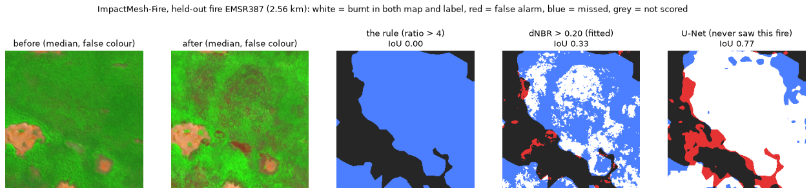
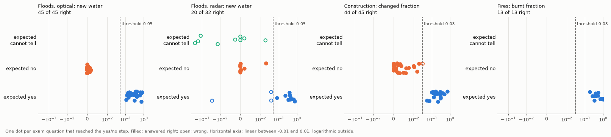
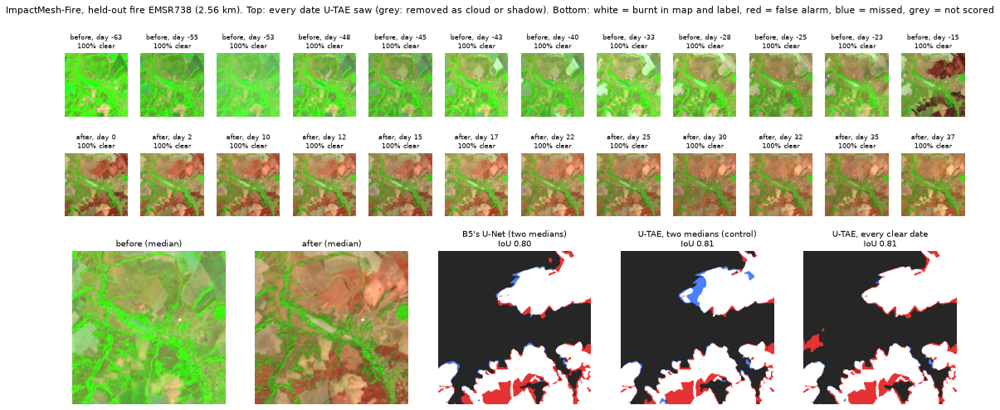
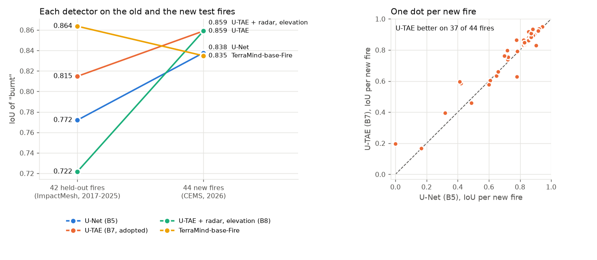

# Methods

Every learned component in this system had to beat the rule it replaces, under a protocol written down
**before any score was computed**. This page gives those protocols, the data, and the full results.

- [1. Principle: a model replaces a rule only if it wins](#1-principle-a-model-replaces-a-rule-only-if-it-wins)
- [2. Data](#2-data)
- [3. Water in optical images](#3-water-in-optical-images)
- [4. Water in radar images](#4-water-in-radar-images)
- [5. The answer path, end to end](#5-the-answer-path-end-to-end)
- [6. Which pixels are cloud or cloud shadow](#6-which-pixels-are-cloud-or-cloud-shadow)
- [7. Which pixels changed through construction](#7-which-pixels-changed-through-construction)
- [8. Which pixels burnt](#8-which-pixels-burnt)
- [9. From a map to yes or no](#9-from-a-map-to-yes-or-no)
- [10. Every clear date instead of two medians](#10-every-clear-date-instead-of-two-medians)
- [11. A second test: fires of 2026, and radar](#11-a-second-test-fires-of-2026-and-radar)
- [12. An independent review, and three ideas tested](#12-an-independent-review-and-three-ideas-tested)
- [13. Comparison with published Sen1Floods11 results](#13-comparison-with-published-sen1floods11-results)
- [14. The agent benchmark](#14-the-agent-benchmark)
- [15. Limits](#15-limits)

## 1. Principle: a model replaces a rule only if it wins

1. **Test data fixed in advance, used once.** No training, setting or threshold is chosen on them.
2. **One main number per step, chosen in advance.** For pixel maps: the IoU (intersection over union)
   of the class that matters, pooled over all test pixels: IoU = ΣTP / (ΣTP + ΣFP + ΣFN). For the answer
   path: accuracy of the final yes / no / cannot-tell answer.
3. **Held-out events, not held-out tiles.** Tiles of one flood share weather, sensor geometry, soil and
   water colour, so they are not independent. Every model is trained with **one whole flood event left
   out** and tested on that event, for each event in turn.
4. **Paired comparison with an honest interval.** Rule and model are scored on the same pixels. The 95 %
   interval of the difference comes from a **cluster bootstrap over flood events** (10 000 resamples of
   whole events). **The model replaces the rule only if the whole interval lies above zero.**
5. **Then the whole answer path** is rerun with the model in place; the answers must not get worse.
6. **Every result is reported, including the losses.**

## 2. Data

| data | use | access |
|---|---|---|
| Sentinel-2 Level-2A (surface reflectance) | the pipeline's optical images | Element84 Earth Search, free COGs |
| Sentinel-1 RTC (radiometrically terrain-corrected backscatter) | the pipeline's radar images | Microsoft Planetary Computer, free, no account |
| Sen1Floods11 (Bonafilia et al. 2020) | 446 hand-labelled 512 × 512 tiles from 11 flood events, with Sentinel-1 and Sentinel-2 | public bucket `gs://sen1floods11` |
| OSCD (Daudt et al. 2018), original files | 24 cities, two dates each (2015-2018), hand-drawn maps of urban change; the band files keep their map position | authors' site (link in the code), labels CC BY-NC-SA, not redistributed here |
| CloudSEN12+ (Aybar et al. 2022, 2024) | about 10 000 Sentinel-2 images (509 × 509 pixels) with expert labels: clear, thick cloud, thin cloud, cloud shadow | Hugging Face `tacofoundation/cloudsen12`, CC0 |
| ImpactMesh-Fire (IBM, DLR, ESA Φ-lab; version 1) | 229 fires (2016-2026), 16 512 patches of 256 × 256 pixels at 10 m, burnt-area labels from Copernicus Emergency Management Service maps; each label carries the fire's date; 42 fires held out by the data set | Hugging Face `ibm-esa-geospatial/ImpactMesh-Fire`, CC BY 4.0 |

**The domain-shift trap, and how it is avoided.** Sen1Floods11's own images are Level-1C optical (top of
atmosphere) and Earth-Engine sigma-naught radar. The pipeline reads Level-2A optical and RTC gamma-naught
radar. A model that is excellent on the data set's images can fail on the pipeline's: the published
Prithvi-EO-2.0 Sen1Floods11 model scores **water IoU 0.817 on Level-1C but 0.634 on Level-2A** (official
test and Bolivia tiles), below the simple rule NDWI > 0 on the same Level-2A tiles (0.638). So two copies of Sen1Floods11 were built **in the pipeline's own
image formats**, same scene, read onto the hand label's pixel grid:

- `core/data/sen1floods11_l2a.py`: Level-2A, 376 tiles, 10 events (India 2016 predates the L2A archive).
  Pixel correlation with the original Level-1C: median 0.989.
- `core/data/sen1floods11_s1rtc.py`: Sentinel-1 RTC, 379 tiles, 10 events (Paraguay's scene is not in
  the archive). VH correlation with the original after a 9 × 9 pixel average: 0.90-0.98 per event; RTC
  is 1.1-2.1 dB brighter, as expected for gamma naught.
- `core/data/oscd_pc.py`: every Planetary Computer Level-2A image within ± 60 days of each OSCD label
  date, on the label's grid, cloud-masked: all 24 cities. Red band against OSCD's own: correlation
  0.97-0.99, lower after a one-pixel shift.
- `core/data/cloudsen12_es.py`: the CloudSEN12+ test images as Earth Search Level-2A, same tile and
  day, on the label's grid: 953 of 975 (192 places). Checked on three images: correlation with the data
  set's own Level-2A 1.000 in the 10 m bands, and lower after a one-pixel shift.

- `core/data/impactmesh_es.py`: for every ImpactMesh-Fire patch, every Earth Search Level-2A image from
  60 to 3 days before the fire and from 7 to 60 days after, on the label's grid, cloud-masked with
  OmniCloudMask: 13 442 of 13 779 patches (1 269 of the 1 270 held-out ones; Earth Search has few 2016
  images). Red band against the data set's own Level-2A: correlation 0.99-1.00, 0.87-0.95 after a
  one-pixel shift.

All decisions are made on these copies.

## 3. Water in optical images

**Question.** Does a learned model mark water in a Sentinel-2 L2A image better than NDWI > 0
(NDWI = (green − NIR) / (green + NIR))?

**Detectors.**
- Rules: NDWI > 0; NDWI > t and MNDWI > t (MNDWI uses short-wave infrared), t fitted on the training events.
- Prithvi-EO-2.0-300M-TL (NASA / IBM) with a UperNet decoder, fine-tuned (the published flood setup).
- TerraMind-1.0-base (IBM / ESA) with a UperNet decoder, fine-tuned.
- A U-Net with a ResNet-18 encoder, trained from scratch.

**Training, fixed in advance and identical for all:** 6 bands (blue, green, red, B8A, B11, B12); random
224 × 224 crops, flips and 90° rotations; batch 16; AdamW, weight decay 0.05; learning rate 5e-5
(pretrained) or 1e-3 (U-Net), cosine schedule; 50 epochs (U-Net 100); cross-entropy with unlabelled and
cloudy pixels ignored; bf16. Prediction on full tiles from overlapping 224 windows. No early stopping,
so no test event is touched. The pretrained encoders were verified tensor-by-tensor against the
published weights.

**Results** (L2A, 376 tiles, 10 events, each held out in turn):

| detector | water IoU | minus NDWI > 0 [95 % interval] |
|---|---|---|
| NDWI > 0 | 0.690 | |
| NDWI > t, fitted | 0.621 | −0.069 [−0.232, +0.038] |
| MNDWI > t, fitted (best rule) | 0.777 | +0.087 [+0.044, +0.162] |
| **U-Net, from scratch** | **0.833** | **+0.143 [+0.083, +0.219]** |
| Prithvi-EO-2.0-300M, fine-tuned | 0.712 | +0.022 [−0.173, +0.187] |
| TerraMind-1.0-base, fine-tuned | 0.698 | +0.008 [−0.184, +0.167] |

The U-Net is adopted. It also beats the best rule (MNDWI fitted) by +0.056 [+0.025, +0.092].

| flood | NDWI > 0 | MNDWI fitted | U-Net | Prithvi | TerraMind |
|---|---|---|---|---|---|
| Bolivia | 0.579 | 0.644 | **0.801** | 0.787 | 0.767 |
| Ghana | 0.675 | 0.765 | **0.778** | 0.770 | 0.763 |
| Mekong | 0.892 | 0.909 | **0.924** | 0.906 | 0.896 |
| Nigeria | 0.865 | 0.897 | **0.925** | 0.919 | 0.907 |
| Pakistan | 0.410 | **0.677** | 0.618 | 0.129 | 0.119 |
| Paraguay | 0.566 | 0.616 | **0.757** | 0.744 | 0.719 |
| Somalia | 0.491 | 0.697 | **0.763** | 0.751 | 0.739 |
| Spain | 0.648 | 0.741 | 0.831 | **0.832** | 0.810 |
| Sri Lanka | 0.759 | 0.811 | 0.850 | **0.851** | 0.831 |
| USA | 0.449 | 0.747 | **0.781** | 0.766 | 0.742 |

**Findings.**
- **Muddy water defeats NDWI.** Suspended sediment reflects near infrared, so flood water can have
  NDWI < 0 (USA tile 217598: median −0.15; the rule finds 2 % of the water, the U-Net 82 %). Water stays
  dark in short-wave infrared, which the U-Net (and MNDWI) exploit.
- **The foundation models are within ~0.03 of the U-Net on 9 of 10 events, and collapse on one.**
  Pakistan is a hazy scene whose dry land is brighter in blue (0.13) than any training event's
  (0.04-0.08); both foundation models label large dry areas as water (IoU 0.13 and 0.12). This matches
  the PANGAEA benchmark (Marsocci et al. 2024), where a U-Net also tops Sen1Floods11.

## 4. Water in radar images

**Question.** Radar sees through cloud. Which detector marks water best in Sentinel-1 RTC: a backscatter
threshold or a learned model?

**Detectors.**
- Rules: VH < t and VV < t, t fitted on the training events (0.1 dB grid); Otsu's threshold per tile on
  VH (the Sen1Floods11 paper's baseline, nothing fitted).
- U-Net (ResNet-18), from scratch, input VV and VH in dB.
- TerraMind-1.0-base, modality S1RTC (TerraMind was pretrained on RTC radar), UperNet decoder, fine-tuned.

Training as in section 3. **New: 3 seeds per model and held-out event**; the main number uses the mean
of the 3 seeds' probabilities.

**Results** (RTC, 379 tiles, 10 events, each held out in turn):

| detector | water IoU | minus VH < t [95 % interval] | single seeds |
|---|---|---|---|
| VH < t, fitted (t ≈ −20.5 dB) | 0.477 | | |
| VV < t, fitted | 0.427 | −0.050 [−0.162, +0.036] | |
| Otsu per tile, VH | 0.199 | −0.278 [−0.351, −0.187] | |
| U-Net, from scratch | 0.558 | +0.081 [−0.002, +0.150] | 0.530, 0.547, 0.578 |
| **TerraMind-1.0-base, fine-tuned** | **0.611** | **+0.134 [+0.090, +0.192]** | 0.606, 0.598, 0.606 |

TerraMind minus U-Net: +0.053 [+0.008, +0.123]. **TerraMind is adopted for radar.** In contrast to the
optical case, the pretrained foundation model wins clearly on radar, and its seeds agree closely (spread
0.008 against 0.048 for the U-Net): radar water is a harder, speckled signal where pretraining pays.

| flood | VH fitted | U-Net | TerraMind |
|---|---|---|---|
| Bolivia | 0.568 | 0.618 | **0.641** |
| Ghana | 0.382 | 0.398 | **0.534** |
| India | 0.400 | **0.479** | 0.468 |
| Mekong | 0.716 | **0.819** | 0.804 |
| Nigeria | 0.563 | 0.746 | **0.799** |
| Pakistan | 0.199 | 0.310 | **0.422** |
| Somalia | 0.125 | **0.261** | 0.250 |
| Spain | 0.607 | 0.682 | **0.704** |
| Sri Lanka | 0.599 | 0.420 | **0.667** |
| USA | 0.419 | 0.467 | **0.498** |

## 5. The answer path, end to end

The benchmark's flood questions ("Was this 5 km area flooded around date D, compared with the weeks
before?") are built from Sen1Floods11 hand labels (yes: tiles with ≥ 15 % flood water; no: dry tiles).
Held fixed: the true periods (before: D−60 to D−10; after: D−3 to D+3), the images, the cloud mask, the
decision rule (new water ≥ 5 % of the area → yes). Only the water detector changes. Each question is
answered by models that never saw its flood event.

**Optical images only** (78 questions): NDWI > 0 0.667 → U-Net 0.744 (+0.077 [+0.000, +0.151]). The
U-Net changes 6 answers, all from a wrong "no" to a right "yes", and breaks none.

**Radar where the optical images cannot tell.** Clouds leave 19 of the 72 questions outside India
without a usable optical image. For those, the pipeline now reads every Sentinel-1 scene of the same
periods; TerraMind gives a water probability per scene; per period, the per-pixel median; water where
> 0.5; the same decision rule.

| answer from | accuracy (72 questions) | "cannot tell" |
|---|---|---|
| optical, NDWI > 0 | 0.639 | 19 |
| optical, U-Net | 0.722 | 19 |
| optical U-Net, then radar with the VH rule | 0.875 | 5 |
| **optical U-Net, then radar with TerraMind** | **0.889** | **5** |

Gain over optical alone: **+0.167 [+0.031, +0.346]**. Radar answered 14 previously unanswerable
questions, 12 of them correctly. The pipeline's own code (`measure_change`) gives the experiment's answer on all 78 questions. The 6 India 2016 questions have no optical image at all; with radar, 2 of 6 are answered
correctly (the 2 "no" questions; the 4 "yes" questions were answered "no").

## 6. Which pixels are cloud or cloud shadow

Every optical measurement starts by removing pixels that show cloud or cloud shadow instead of the ground.
Until now ESA's scene classification (SCL, made by ESA's Sen2Cor processor from fixed tests on brightness
and colour) decided: unusable where SCL is 3 (shadow), 8, 9 (cloud) or 10 (cirrus). A cloud let through
spoils a measurement; a clear pixel thrown away can turn an answer into "cannot tell".

**Test.** The 975 high-quality test images of CloudSEN12+ (195 places, 5 dates each), in the Earth Search
copy (953 images, 192 places), the kind of image the pipeline reads. Main number: IoU of "unusable"
(thick cloud, thin cloud and shadow together), pooled; the interval resamples whole places (10 000
times). Candidates: OmniCloudMask (Wright et al. 2025) used exactly as published; a U-Net (ResNet-18)
trained from scratch and TerraMind-1.0-base fine-tuned on the 8 490 training images (7 bands, 20
epochs, 3 seeds); and a stronger SCL rule (more classes, the mask widened by k pixels) chosen on the
validation part. Leakage checked from the catalogue: no test place is in OmniCloudMask's training
material (nearest image 15.4 km away); the 16 test images taken on the same day and tile as one of its
training images were also checked apart.

| detector | IoU of unusable | minus SCL [95 % interval] | clouds let through | clear pixels thrown away |
|---|---|---|---|---|
| SCL 3/8/9/10 (the rule) | 0.644 | | 26 % | 13 % |
| SCL 3/7/8/9/10, widened 5 px (chosen on validation) | 0.681 | +0.037 [+0.026, +0.048] | 16 % | 21 % |
| U-Net, from scratch | 0.844 | +0.200 [+0.181, +0.220] | 11 % | 6 % |
| TerraMind-1.0-base, fine-tuned | 0.878 | +0.234 [+0.213, +0.255] | 7 % | 6 % |
| **OmniCloudMask, as published** | **0.885** | **+0.241 [+0.221, +0.261]** | **7 %** | **5 %** |

OmniCloudMask also beats TerraMind (+0.007 [+0.001, +0.013]) and the stronger rule (+0.204); without
the 16 same-day images, +0.243. By class (IoU, SCL → OmniCloudMask): thick cloud 0.60 → 0.86, thin
cloud 0.20 → 0.54, shadow 0.33 → 0.67. Widening the rule's mask trades one mistake for the other; the
networks reduce both.

*A typical test image (chosen by a fixed rule: the image whose SCL score is closest to SCL's overall
score). On bright sand SCL calls most cloud shadow clear ground: IoU 0.64 against 0.97.*

**Two versions of ESA's rule.** On the data set's own Level-2A copies of the same scenes (made earlier by
Google Earth Engine), SCL scores only 0.541; only 263 of 953 images have identical SCL maps in both
copies. In a random sample of 12, every differing image is one that ESA has reprocessed (processing baseline 05.00)
on Earth Search. The networks score the same on both copies (OmniCloudMask 0.885 and 0.888).

**In the pipeline.** OmniCloudMask's two networks run from ONNX files on the CPU; the library's
procedure around them (overlapping windows, per-window scaling, blended edges, no-data handling) is
ported to NumPy (`core/models/cloud.py`, MIT notice kept). It is identical to the library pixel for pixel
on 7 awkward image shapes, and on the 953 test images agrees with the library's GPU result on 99.996 % of
pixels (IoU 0.885 in both). Cost: about 0.25 s per image date for a 5 km area.

**End to end.** All 150 benchmark questions with only the cloud detector changed: 0.853 → 0.860
(+0.007 [−0.015, +0.029]); 3 answers changed (2 fixed, 1 broken). The condition was "not worse", and it
holds. The large pixel gain hardly shows here, because few answers hinge on a few percent of pixels. On
Sen1Floods11's labelled flood water, OmniCloudMask marks 22 % as unusable against 24 % for SCL, so it
does not mistake dark flood water for shadow.

## 7. Which pixels changed through construction

For a construction question the pipeline makes two median images (per pixel and band, the median of the
clear observations before, and after). The rule it used: per band, the change of the median divided by
the before images' date-to-date scatter (1.4826 × median absolute deviation, at least 0.02); "changed"
where the root mean square of this ratio over 5 bands is above 4; "yes" if at least 3 % of the area
changed. It is a signal-to-noise cut, and it flags *every* change: a harvest, a flood or a dry summer
lawn passes it as easily as a new building. Asked "was there new construction between summer 2022 and
summer 2023?" about farmland flooded in May 2023 (Conselice, Italy), it answered "yes".

**Data: OSCD put back on the map.** OSCD (Daudt et al. 2018) has hand-drawn maps of **urban change only**
for 24 cities, two dates each (2015 to 2018). A flood or a harvest is "no change" in it, which is exactly
what a construction question needs. Common copies of OSCD have lost the images' map position; the
authors' original files keep it (each city's band files are GeoTIFFs on a 10 m latitude-longitude grid,
and the label is drawn on that grid). So every Level-2A image within ± 60 days of each label date was read
from **Planetary Computer** onto the label's grid (Earth Search lacks most 2015-2016 images), cloud-masked
with OmniCloudMask, and turned into the pipeline's two median images (one city, Rio, needed ± 90 days).
Alignment check before any score: correlation of the red band with OSCD's own 0.97-0.99, and 0.84-0.94
after a one-pixel shift.

**Test.** Two pairs of cities are neighbours (Saclay east and west; Paris and Bercy), so there are **22
independent groups**. Each group is mapped by networks trained on the other 21 (**leave one group out**).
Scored pixels: those with at least 2 clear observations before and 1 after, the same for every detector.
Main number: IoU of "changed", pooled; the interval resamples the 22 groups (10 000 times). Candidates:
the rule with its threshold refitted on the training groups (from 2, 3, 4, 5, 6, 8), an honest baseline;
**FC-Siam-diff** (Daudt, Le Saux, Boulch 2018; 1.4 M parameters) trained from scratch; and **TerraMind-1.0-base
as a Siamese network**: the same pretrained encoder on the before and on the after image, the difference
of their features to a UperNet decoder (TerraTorch's `TemporalWrapper`), fine-tuned (98 M parameters).
Both networks: 7 bands, 224 × 224 crops, 3 000 steps, cross-entropy + Dice loss, no early stopping, 3
seeds, mean of the 3 seeds' probabilities > 0.5. 138 training runs in all.

| detector | IoU | F1 | precision | recall | minus the rule [95 % interval] |
|---|---|---|---|---|---|
| the rule (ratio > 4) | 0.188 | 0.316 | 0.406 | 0.258 | |
| the rule, threshold refitted | 0.188 | 0.316 | 0.406 | 0.258 | +0.000 |
| FC-Siam-diff, from scratch | 0.225 | 0.368 | 0.682 | 0.252 | +0.038 [−0.012, +0.094] |
| **TerraMind-1.0-base, Siamese, fine-tuned** | **0.301** | **0.463** | **0.587** | **0.383** | **+0.114 [+0.052, +0.180]** |

The refitted rule chose 4 in all 22 folds: the rule was already at its best, and the network wins by
doing something the rule cannot. TerraMind is better in 21 of 24 cities; its single seeds give 0.294,
0.304 and 0.281. The small network trained from scratch becomes purer than the rule but finds no more
change; the pretrained encoder gains on both. (Published OSCD numbers use one Level-1C image per date,
13 bands and the 10 official test cities, e.g. FC-Siam-diff F1 0.58; ours are median images of several
dates, 7 Level-2A bands, all 24 cities left out by group. Not the same experiment.)

*Dubai (chosen by a fixed rule: the city whose rule IoU is closest to the rule's overall 0.19). White:
changed in both map and label; red: false alarm; blue: missed. TerraMind's map comes from networks that
never saw Dubai.*

**End to end.** All 150 benchmark questions with only the change detector changed: 0.860 → 0.860; 2
answers changed (a chip factory under construction fixed, a stable park broken). Not worse, the
condition. **False alarms:** the 78 flood questions of the benchmark asked as "was there new
construction?" (right answer always "no"): false "yes" 25 with the rule, 21 with TerraMind (difference
−0.051 [−0.191, +0.048] over 11 flood events; the condition was "not more"); the median area marked
changed falls from 7.5 % to 2.1 %. Conselice: the rule "yes" (4.5 % changed), TerraMind "no" (1.0 %).
So TerraMind now draws the change map for construction questions, from ONNX files on the CPU (3 seeds,
each trained on all 24 cities; about 1.5 minutes per question on a CPU, against about 10 s for the rule).

## 8. Which pixels burnt

A "vegetation loss" question ("did a wildfire burn this area?") used the same change rule as construction
(section 7). Of the benchmark's 13 fire questions it answered 9 right; it said "no" for four large,
well-documented fires (Jasper, Pedrógão Grande, Mati, Valparaíso).

**Data.** ImpactMesh-Fire: burnt-area maps drawn by the Copernicus Emergency Management Service after 229
fires, cut into 2.56 km patches; the data set holds out **42 fires** (1 270 patches, mostly European, also
Bolivia, Mexico, Cyprus, the Canary Islands) that appear in neither its training nor validation part. All
patches were re-read as the pipeline's two Earth Search median images (section 2). Four benchmark fires
are in ImpactMesh's training part; they and six other fires at the same places were removed from training,
so the benchmark is a fair test too. Training: 12 173 patches from 177 fires.

**Test.** Main number: IoU of "burnt", pooled over the held-out patches' scored pixels (labelled, at least
2 clear observations before and 1 after; the same for every detector); the interval resamples the 42 fires
(10 000 times). If two passing networks lie within each other's interval, the cheaper one is taken.
Candidates: the change rule with a refitted threshold, and **dNBR** (the standard burn index: the drop of
NBR = (B08 − B12) / (B08 + B12)) with a fitted threshold, both fitted on the training fires; a **U-Net**
(ResNet-18 encoder, 14 M parameters) from scratch on the two median images stacked (14 bands); B4's
**Siamese TerraMind-1.0-base** fine-tuned; and **Prithvi-EO-2.0-300M-BurnScars** as published (US burn
scars at 30 m, one after image; our after median averaged to 30 m). Networks: 10 000 steps, cross-entropy
+ Dice, 3 seeds, mean probability > 0.5.

| detector | IoU | F1 | precision | recall | minus the rule [95 % interval] |
|---|---|---|---|---|---|
| the rule (change / scatter > 4) | 0.050 | 0.096 | 0.708 | 0.051 | |
| the rule, threshold refitted (2) | 0.317 | 0.481 | 0.570 | 0.416 | +0.266 [+0.181, +0.406] |
| dNBR > t, t fitted (0.20) | 0.560 | 0.718 | 0.797 | 0.653 | +0.510 [+0.413, +0.636] |
| Prithvi-EO-2.0-300M-BurnScars, as published | 0.483 | 0.652 | 0.813 | 0.544 | +0.433 [+0.255, +0.645] |
| TerraMind-1.0-base, Siamese, fine-tuned | 0.793 | 0.885 | 0.874 | 0.895 | +0.743 [+0.700, +0.778] |
| **U-Net, from scratch** | **0.772** | **0.871** | **0.876** | **0.867** | **+0.722 [+0.671, +0.773]** |

All three networks pass. TerraMind minus U-Net is +0.021 [−0.009, +0.044]; the interval contains zero
and the U-Net has 7 times fewer parameters, so **the U-Net is adopted**, as the protocol fixed. It beats
the best fitted rule (dNBR) by +0.212 [+0.104, +0.300] and is below it on 1 of 42 fires; single seeds
0.749, 0.776, 0.764. The change rule marks almost nothing: a burn changes the bands by about a third,
less than four times the date-to-date scatter of summer vegetation. Prithvi, seeing only the after image,
cannot tell a new burn from an old scar or bare soil. For reference only (not a pipeline candidate, since
the pipeline does not assemble its inputs): IBM and ESA's TerraMind-base-Fire, fine-tuned on ImpactMesh
with four single dates, radar and elevation, reaches 0.864 on the same pixels. Setup check: our way of
running Prithvi-BurnScars gives 0.848 on its own HLS test scenes (published 0.875).

*A held-out fire in Bolivia (chosen by a fixed rule: among patches at least 30 % burnt, the one whose
U-Net IoU is closest to the overall 0.772). False colour (SWIR, near infrared, red): vegetation green,
burns dark red-brown. White: burnt in map and label; red: false alarm; blue: missed.*

**End to end.** All 150 benchmark questions with only the vegetation-loss detector changed: 0.860 →
**0.887**, +0.027 [+0.006, +0.059]; all 13 fire questions right (the U-Net marks 19 % to 100 % of the
areas burnt; the rule 0.4 % to 24 %). **False alarms:** 570 held-out patches with no burnt pixel
(unburnt land next to a fire, in the fire season), answered with the pipeline's 3 % decision: false "yes"
3.9 % with the U-Net, 5.1 % with the rule (−1.2 points [−6.5, +3.6]; the condition was "not more"); the
fitted dNBR would say "yes" on 24.9 % of them. On 462 patches at least 15 % burnt: "yes" 97.8 % against
26.6 %. So the U-Net now marks burnt pixels for vegetation-loss questions, from ONNX files on the CPU
(about 80 s per question, against about 7 s for the rule).

## 9. From a map to yes or no

The last step of the answer path turns a map into an answer with two thresholds set by hand before any
network existed: "yes" if the new water is at least 0.05 of the area (floods, optical and radar), or if
the changed fraction is at least 0.03 (construction, vegetation loss). Once every map came from a trained
network, the question was whether fitted thresholds, or a small classifier, answer better.

**Test.** One complete run of today's path on all 150 benchmark questions, keeping every measured number;
135 reach the yes/no step. The only labelled yes/no questions are the benchmark's, so each candidate is
scored by **leaving one of the benchmark's 83 groups out** (fitted on the other 82, answering the
left-out group). Candidates: one threshold per kind of measurement (optical flood, radar flood,
construction, fire) from a fixed list, ties going to today's value; and a logistic regression per kind
(floods: new water, water before, water after; others: log changed fraction). Adopted only if the whole
interval of the accuracy difference (resampling the 83 groups) lies above zero.

| | accuracy | minus today [95 % interval] |
|---|---|---|
| hand-set thresholds | 0.887 | |
| fitted thresholds, leave one group out | 0.887 | +0.000 [+0.000, +0.000] |
| logistic regression, leave one group out | 0.873 | −0.013 [−0.033, +0.000] |

**The hand-set thresholds stay.** For optical floods, construction and fires the "yes" and "no"
questions are separated by a wide gap around the threshold (45/45, 44/45, 13/13 right), so no threshold
can do better. 9 of the 12 wrong radar answers are questions the benchmark expects "cannot tell" (2016
floods without Level-2A optical images, polar night), written before radar was part of the path: radar
now answers them. A lower radar threshold (0.03) would fix two answers of one flood, but no other flood
supports it, and leaving groups out refuses it.

*One dot per benchmark question that reached the yes/no step, placed by its measured number and its
expected answer; filled right, open wrong; dashed: the threshold.*

## 10. Every clear date instead of two medians

Every network above sees a place through two median images. A median removes clouds but discards when each
image was taken: a burn scar is darkest just after the fire and fades as plants regrow. The question here
is whether a network that reads **every clear date, with its day**, marks burnt pixels better than the
U-Net of section 8, on the same 42 held-out fires and the same pixels.

**Data.** Section 8's patches, windows and cloud masks, re-read with each date kept: dates with at least 1 %
clear pixels, at most 12 per window (the clearest), in time order. 13 442 patches, 18.4 dates on average
(about 10 before, 9 after).

**Network.** **U-TAE** (Garnot and Landrieu, 2021), implemented here: a convolutional encoder applied to
each date with shared weights, a lightweight temporal attention (L-TAE: 16 heads, one learned query each)
at the coarsest scale that weights the dates at every position, using a sinusoidal code of the day and a
"before"/"after" code, and a U-Net decoder. The same attention weights collapse the skip connections over
time. 1.1 million parameters, trained from scratch with section 8's settings (10 000 steps, batch 8, 3
seeds; about 2.6 hours per run on one A10). **Control:** the same U-TAE given only the two medians, so that
a gain can be attributed to the dates rather than to the architecture. Adopted only if the whole interval
over the U-Net is above zero and false alarms do not rise.

| detector | IoU of burnt | precision | recall | minus the U-Net [95 %] |
|---|---|---|---|---|
| U-Net, two medians (section 8, in use) | 0.772 | 0.876 | 0.867 | |
| Siamese TerraMind, two medians (section 8) | 0.793 | 0.874 | 0.895 | +0.021 [−0.009, +0.044] |
| U-TAE, two medians (control) | 0.783 | 0.841 | 0.920 | +0.011 [−0.020, +0.030] |
| **U-TAE, every clear date** | **0.815** | 0.871 | 0.926 | **+0.043 [−0.011, +0.077]** |

**The U-Net stays.** U-TAE gives the best map measured so far, better on 30 of 42 fires, with higher recall
at the same precision and the same false "yes" rate on 570 unburnt patches (3.9 %). But the interval
reaches below zero: one of the largest fires (EMSR506, 0.86 with the U-Net, 0.77 with U-TAE) carries much
weight in the pooled IoU. **The dates help:** U-TAE on every date minus the same network on two medians is
+0.031 [+0.003, +0.049], wholly above zero. On 42 fires, "probably better by about 0.04" is not enough
to pass the rule written beforehand; a second, newer set of fires would decide it. (It did: section 11.)

*One typical held-out patch (chosen by a fixed rule: U-TAE's IoU closest to its pooled value). Top: every
date U-TAE saw, false colour (SWIR, NIR, red), grey where masked. Bottom: the two medians and the three
maps; white burnt in map and label, red false alarm, blue missed.*

## 11. A second test: fires of 2026, and radar

Section 10 left U-TAE "probably better" on 42 fires. Two questions were then tested under one protocol,
written before any score: does adding **radar and elevation** help, and do the candidates beat the U-Net on
**fires later than every fire they were trained on**? The published **TerraMind-base-Fire** (IBM and ESA,
fine-tuned on ImpactMesh-Fire with four dates of optical, radar and elevation; 0.864 on its held-out fires)
was a candidate too.

**New test set.** The 45 wildfire activations of the Copernicus Emergency Management Service from 26
January to 15 September 2026, all later than ImpactMesh's newest fire. ImpactMesh does not publish its
label rule; on one of its fires (EMSR859, 138 patches) this one reproduces its label files exactly (IoU
1.000): per mapped area, the grading map (else the last delineation map), every pixel a "burnt area"
polygon touches. Taking only pixels whose centre is inside gives 0.897, merging all maps 0.875. Land
outside the mapped area is left unlabelled. Patches of 2.56 km on a 2 560 m grid, kept if at least half
inside the mapped area: **2 215 patches from 44 fires** (one too small), 42 of them in Europe. The images
exactly as sections 8 and 10.

**Candidates.** (1) Section 10's U-TAE, as trained. (2) **U-TAE with radar and elevation**: the same
network with 12 inputs per date: optical dates and Sentinel-1 RTC radar dates (VV, VH in dB, at most 8 per
window) in one sequence in time order, each with a flag, and Copernicus DEM elevation on every date;
trained as section 10 (3 seeds, about 4.8 hours per run on one A10). (3) TerraMind-base-Fire as published,
its four-date inputs built by our own code from Planetary Computer. Check before any score: on the 42
held-out fires our inputs give 0.863 against 0.864 with the data set's own files (−0.001 [−0.024, +0.009]),
although our date rule picks the same day as the data set only 15-82 % of the time.

**Rule.** Pass if the whole interval over the U-Net (resampling the fires) is above zero; of those, the
best, unless a smaller one lies within the best one's interval; then not adopted if false alarms rise or
the benchmark gets worse.

| detector | parameters | IoU of burnt, 44 new fires | minus the U-Net [95 %] | false "yes", 701 unburnt patches | IoU, 42 held-out fires |
|---|---|---|---|---|---|
| U-Net, two medians (section 8) | 14.4 M | 0.838 | | 0.7 % | 0.772 |
| **U-TAE, every clear date (section 10)** | 1.14 M | **0.859** | **+0.021 [+0.012, +0.035]** | 0.6 % | 0.815 |
| U-TAE with radar and elevation | 1.14 M | 0.859 | +0.021 [+0.012, +0.033] | 0.3 % | 0.722 |
| TerraMind-base-Fire, as published | 168 M | 0.835 | −0.003 [−0.020, +0.019] | 0.4 % | 0.864 |

**U-TAE replaces the U-Net.** Both U-TAE networks pass and tie with each other (+0.000 [−0.010, +0.006]),
so the one with fewer parameters and inputs, needing no radar or elevation, was taken. False alarms did not
rise; the benchmark is unchanged (0.887; all 13 fire questions right with either network). U-TAE is better
on 37 of the 44 new fires. In the pipeline it reads every clear date of the question's two periods (the
training copy's date rule) from ONNX files on the CPU, in 10-25 s per 5 km area instead of 0.5 s.

**Radar did not help, and on four old fires it hurt.** On the held-out fires the radar network scores
0.722, against 0.815 without radar, all three seeds alike. The loss sits in four fires (Bolivia 0.81 → 0.52;
also Scotland, northern Italy, Croatia), mostly as missed burnt land. Our radar equals the data set's own
(correlation 1.000); removing the radar dates restores 0.74. Why the network misreads radar there is not
known. Since it brings no gain on the new fires, the radar network was dropped and this was not followed
further; radar for fires under cloud, where it could still matter, is untested.

**An independent test changes the ranking.** TerraMind-base-Fire falls from 0.864 on ImpactMesh's held-out
fires to 0.835 on the new fires, level with the U-Net, while our networks rise (U-TAE 0.815 → 0.859).
Against it on the new fires: U-TAE +0.024 [+0.010, +0.037]. The new fires may simply be easier for
two-period optical maps; whether ImpactMesh's held-out fires resemble its training fires closely enough to
flatter a model fine-tuned on them was not tested.

*Left: each detector on the 42 held-out fires and on the 44 new fires. Right: one dot per new fire, the
U-Net's IoU against U-TAE's.*

## 12. An independent review, and three ideas tested

After section 11, a separate reviewer read every record of the project and named the three changes most
likely to improve the measured results. Each was tested under a protocol written before its first score.
From the review, every protocol also stated two things in advance:
- **the smallest gain it could detect;**
- **a margin for "not worse":** a fixed loss allowed, instead of "the interval is not wholly below zero".

**1. Flooded land is not construction (adopted).**
- *The problem:* the construction network (section 7) was trained on OSCD, which has no floods. Asked
  "was there construction?" about the benchmark's 78 flooded places, it said "yes" 21 times.
- *Three candidates:*
  - **W:** remove from its map the pixels that the water network (section 3) sees as water in the after
    image;
  - **N:** retrain it with 220 flooded places labelled "no change". They were recorded through the real
    pipeline at Sen1Floods11's chips; each flood event was scored by networks that never saw it;
  - **N+W:** both.

| detector | false "yes" (of 78) | minus the network [95 %] | OSCD urban change (IoU) | minus the network [95 %] |
|---|---|---|---|---|
| construction network (section 7) | 21 | | 0.301 | |
| **W: water removed** | **6** | **−0.192 [−0.333, −0.072]** | **0.304** | **+0.003 [−0.007, +0.017]** |
| N: flooded places as "no change" | 1 | −0.256 [−0.429, −0.112] | 0.294 | −0.008 [−0.031, +0.019] |
| N+W | 0 | −0.269 [−0.441, −0.121] | 0.291 | −0.011 [−0.034, +0.016] |

- **W passes and was adopted.** It is the only candidate within the urban-change margin (lower end
  ≥ −0.03).
- **N learnt what a flood looks like** from other floods, but it also became more cautious about real
  construction: Las Vegas −0.075, land made from the sea in Beihai −0.046. It missed the margin by 0.001.
- **In the benchmark,** W lost one answer, within the 1 allowed: a filling reservoir asked as "did the
  land or water surface change?", where new water is the change.

**2. More urban-change labels from SpaceNet 7 (not adopted).**
- *What was added:* buildings new between the first and last month of SpaceNet 7's 60 areas (hand-drawn
  outlines, 2017-2020), read onto Sentinel-2's grid. The outlines and the 10 m grid agree to well under a
  pixel.
- *Result:* urban change fell from 0.304 to 0.222 (−0.082 [−0.136, −0.036]), and to 0.204 with the
  flooded places added as well.
- *Why:* SpaceNet 7 marks new buildings, OSCD all urban change. The network learnt the narrower meaning
  (recall 0.375 → 0.24).

**3. Radar water from 92 more flood events (not adopted).**
- *What was added:* MMFlood's flood maps (Copernicus emergency service outlines, 2014-2021), re-read as
  Planetary Computer RTC radar on their own grid. The copy agrees with MMFlood's own radar (VH correlation
  0.945 after a 9 × 9 average). Permanent water came from JRC Global Surface Water, so that "water" means
  what it means in Sen1Floods11. Events that coincide with a Sen1Floods11 event were removed.
- *Result:* water IoU on Sen1Floods11's events fell from 0.611 to 0.568 (−0.043 [−0.076, −0.014]), with
  precision up and recall down (0.72 → 0.62).
- *Why:* the emergency outlines mark less water than hand labels do.

**What this shows.** More data helped only where it meant the same thing as the test labels. Twice, a
larger but narrower label set made the network more cautious, and both losses were certain. The cheapest
idea, with no new training at all, was the one that won.

## 13. Which images a fire question uses

**The defect.** A wildfire question asked about a day borrowed the flood periods:
- before: day −60 to day −10;
- after: day −3 to day +3.

The after period therefore began *before* the fire. The burn network (sections 10-11) was trained and
tested only with after images from day +7 to day +60 (or +90). The benchmark never met this route,
because its fire questions carry their own periods.

**Three ways to choose the images** (protocol written before any score):
- **A, the old route:** as above, with one wider retry. For a month, its 15th day.
- **T, the training periods:** before day −60 to −3, after day +7 to +60; if too cloudy, day −120 to −3 and
  +7 to +90. Every image.
- **S, the 8 nearest images:** within T's wider limits, on each side, the 8 images nearest the fire that
  are at least 10 % cloud-free (fewer if fewer exist).

A question about a month uses its first day for the before side and its last day for the after side.

**Questions with known answers.** 228 in all, from 55 fires:
- **2026 fires:** at most 3 burnt (CEMS burnt fraction ≥ 0.10, answer "yes") and 3 unburnt (0, answer "no")
  2.56 km patches per fire, drawn at random. Each is asked about the fire's day.
- **The benchmark's 13 fires:** asked by month, as they are worded.

The main number is the share answered correctly; "cannot tell" counts as not correct. Candidate minus A,
95 % interval from resampling the fires. Condition: false "yes" may rise by at most 0.03.

| rule | right | cannot tell | false "yes" | month questions right |
|---|---|---|---|---|
| A, old route | 0.855 | 0.048 | 0.000 | 8 of 13 |
| T, training periods | 0.996 | 0 | 0.009 | 13 of 13 |
| **S, 8 nearest (adopted)** | **0.996** | **0** | **0.009** | **13 of 13** |

- **Both T and S pass:** right answers +0.140 [+0.076, +0.221]; false "yes" +0.009 [0.000, +0.028].
- **They gave the same answer to every question.** The protocol then takes S: it needs fewer dates, so the
  network runs faster on a CPU.
- **The old route's 33 errors** were mostly burnt places answered "no" (22).
- **The one remaining error** is an unburnt moorland patch in Scotland, with after images up to
  mid-October. It is either a burn outside the mapped area or autumn browning. Reaching further in time
  lets seasons pose as damage; that is why the reach has limits.

Floods are unchanged, because water drains within days. Construction is unchanged, because those questions
compare two given seasons.

## 14. Comparison with published Sen1Floods11 results

Here the setup is the published one: the data set's own images (radar: Earth Engine sigma naught;
optical: Level-1C, 13 bands) and its official split (train 252, validation 89, test 90 tiles; Bolivia,
15 tiles, held out apart). Settings were chosen on the validation part only: for the U-Net, encoder
(ResNet-18 / 34) and loss (cross-entropy, or cross-entropy + Dice), 4 combinations; for TerraMind, the
learning rate (5e-5 / 1e-4). The chosen setting was trained with 5 seeds; whether to average the 5 seeds
and to average 8 flipped and rotated views at prediction time was also decided on validation. The test
part was scored once, at the end. Pooled over all test pixels, as in the published papers.

| input | model | test water IoU | test mIoU | single seeds (water IoU) | published (same test part) |
|---|---|---|---|---|---|
| radar | rule VH < t (fitted) | 0.533 | 0.728 | | |
| radar | U-Net | 0.663 | 0.806 | 0.650-0.666 | |
| radar | **TerraMind-1.0-base** | **0.672** | **0.811** | 0.654-0.679 | TerraMind-1.0-base: 0.680 / 0.811 [1] |
| optical | **U-Net** | **0.830** | **0.903** | 0.822-0.842 | TerraMind-1.0-base: 0.823 / 0.897 [1] |
| optical | TerraMind-1.0-base | 0.824 | 0.899 | 0.812-0.824 | |
| radar + optical | **U-Net** | **0.844** | **0.911** | 0.833-0.844 | U-Net: mIoU 0.914 [2] |
| radar + optical | TerraMind-1.0-base | 0.821 | 0.897 | 0.801-0.824 | |

[1] Jakubik et al. 2025, Table 8. [2] PANGAEA, Marsocci et al. 2024, Table 5.

**Our numbers reproduce the published ones to within 0.01**, in both directions: optical U-Net +0.007
water IoU over the published TerraMind result; radar TerraMind −0.008; radar + optical U-Net −0.003 mIoU.
These differences are smaller than the spread between single seeds (about 0.02), so the honest
statement is *on par with the published state of the art*, not *better*. Two things this establishes:
our training setup is sound, and the large losses in sections 3 and 4 come from the harder test (a whole
flood never seen, in the pipeline's own image formats), not from weak training. Combining radar and
optical gives the best water IoU of all (0.844). On Bolivia, the held-out country, the optical models
keep their accuracy (0.79-0.81) while the radar models drop (0.49).

## 15. The agent benchmark

`eval/benchmark.jsonl` (44 questions) and `eval/benchmark_v2.jsonl` (150): flood questions from
Sen1Floods11 labels, construction and wildfire sites with verified dates, stable control sites, and
questions designed to be unanswerable (polar night, before Sentinel-2, the future). Three orchestrations
were compared over one MCP tool server: a free agent loop (Claude Agent SDK), a fixed LangGraph workflow
with a local model (Qwen3, vLLM, one GPU), and the same graph with Claude.

- **Model, orchestration fixed:** Claude vs Qwen3-8B in the same graph: 19 questions fixed, 2 broken
  (sign test p = 0.0002).
- **Arithmetic belongs in code:** computing the date windows in code instead of the model raised
  Qwen3-8B from 0.48 to 0.66.
- **Reasoning mode:** Qwen3-8B with thinking on: 0.48 → 0.77 (p = 0.002), at 5× the latency.

The final design follows from this: Claude holds the conversation, **all measurement is one
deterministic function** (`measure_change`), and two checks in code verify that the reply's answer and
every number in it come from that function's results.

The benchmark compared the graph as it was then: its boxes called the four step tools, which measure with
the first rules (water index, change rule, ESA's cloud classification). Since then the graph's default
(`EO_GRAPH_VERSION=4`) measures through the same `measure_change`, so every variant uses the detectors of
sections 3-13. The model still checks the question, reads the place and time, and writes the reply. The
earlier versions are kept for reproduction.

## 16. Limits

- 10 flood events give wide intervals; the radar U-Net's gain is not significant (interval touches 0).
- One seed per model in the optical comparison; three in the radar comparison.
- The foundation models used the published Prithvi training settings, not tuned for each model.
- The benchmark's flood questions come from the same 10-11 events as the training data (each question is
  answered by a model that never saw its event, but they are not new places).
- Radar answers have no evidence figure yet.
- Thin cloud stays hard for every cloud detector (IoU 0.54 at best). The cloud U-Net was trained for a
  fixed 20 epochs and may be undertrained.
- OSCD has 24 cities and only urban change. Removing the water network's water (section 12) brought the
  false "yes" on flooded areas asked about construction from 21 to 6 of 78; the remaining 6 are floods
  whose change is not open water. A filling reservoir asked as "any change" now counts as no change.
- The change network is trained on Planetary Computer's Level-2A images and used on Earth Search's. The
  end-to-end tests ran on Earth Search and did not get worse, but there are no pixel labels there.
- The benchmark could gain at most one construction answer (the rule already got 44 of 45); the change
  network's gain is shown at pixel level, not in the benchmark.
- The benchmark has no vegetation-loss question whose right answer is "no"; the false-alarm test uses
  2.56 km patches, smaller than the benchmark's 3-5 km areas. The burn network was trained only on fires:
  vegetation loss from clear-cutting or drought is untested.
- The benchmark's "cannot tell" questions were written for an optical-only system; radar now answers nine
  of them, and they count as wrong. Re-labelling them would be a change of the benchmark, not made here.
- ImpactMesh-Fire is mostly European; 10 of the 13 benchmark fires are elsewhere (all answered right, but
  13 questions are few).
- 42 held-out fires are too few to show a gain of about 0.04 in IoU of burnt (section 10): one large fire
  can move the pooled score by several hundredths. The time-series network was tested on fires only.
- The image choice for fire questions (section 13) was tested on the 2026 fires, which section 11 had
  already used to choose the burn network. These are different questions (which images, not which
  network), but the set is not fresh for the network.
- Both pixel-level fire test sets are mostly European (40 of 42 held-out fires, 42 of 44 new fires); only the
  benchmark's fires (10 of 13 outside Europe) test other regions. The new fires were mostly clear, so radar
  was not tested where optical images fail.
